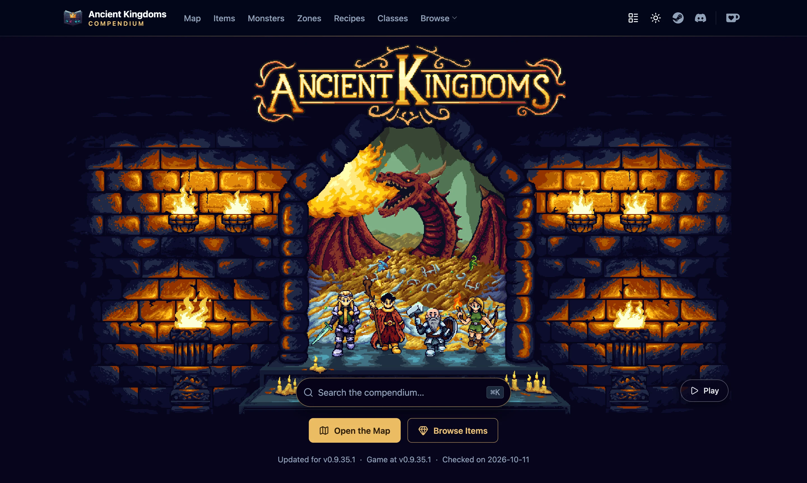
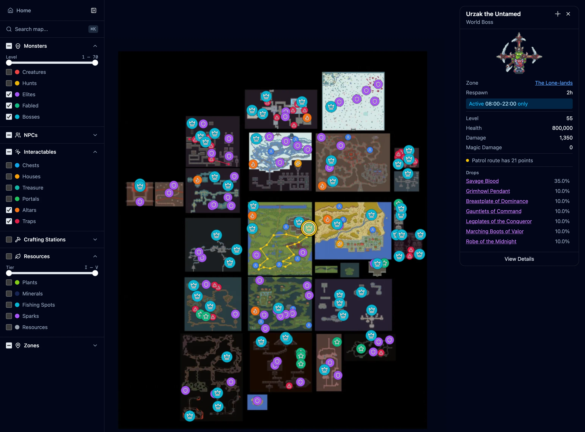
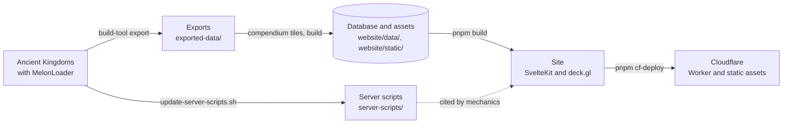

# Ancient Kingdoms Compendium & Mods

An interactive world map and a searchable compendium for [Ancient Kingdoms](https://store.steampowered.com/app/2241380/Ancient_Kingdoms/), an old-school RPG inspired by classic MMORPGs, built from the game's own data. The repository also holds the MelonLoader mods that read that data out of the game, and four mods for players.

[Open the compendium](https://ancient-kingdoms.compendiums.org) · [Steam Guide](https://steamcommunity.com/sharedfiles/filedetails/?id=3616580411) · [Project page](https://glockyco.com/projects/ancient-kingdoms/) · [Support on Ko-fi](https://ko-fi.com/wowmuch)

## What's inside

- **Map** (`/map`). The world of Eratiath with its zones, monsters, NPCs, gathering spots, chests, treasure, altars, traps, portals, houses, and crafting stations, with filters and search.
- **Reference pages.** Items, monsters, NPCs, zones, quests, recipes, skills, classes, mercenaries, professions, and more: where each one is, what it drops or needs, and how they connect.
- **Mechanics** (`/mechanics`). How combat, experience, monster spawns, death, crafting, and the game's other systems work, with the numbers the game code uses.

Some content is left out on purpose, partly at the developers' request, such as zones that have not shipped.

## Mods for players

Install [MelonLoader](https://github.com/LavaGang/MelonLoader) in the game, then put the DLLs in the game's `Mods` folder. Always include FieldDefaultValueHookFix.

| Mod | What it does | Download |
| --- | --- | --- |
| [FieldDefaultValueHookFix](mods/FieldDefaultValueHookFix/README.md) | Prevents a crash on world entry under MelonLoader. | [DLL](https://ancient-kingdoms.compendiums.org/mods/FieldDefaultValueHookFix.dll) |
| [BetterBestiary](mods/BetterBestiary/README.md) | Shows every monster's full Bestiary page, with lore, stats, loot, and skills. | [DLL](https://ancient-kingdoms.compendiums.org/mods/BetterBestiary.dll) |
| [BossSkillTracker](mods/BossSkillTracker/README.md) | Shows the ability cooldowns of the bosses, elites, and fabled monsters you fight. | [DLL](https://ancient-kingdoms.compendiums.org/mods/BossSkillTracker.dll) |
| [BossTracker](mods/BossTracker/README.md) | Lists nearby bosses, elites, and fabled monsters with their status, distance, direction, and respawn time. | [DLL](https://ancient-kingdoms.compendiums.org/mods/BossTracker.dll) |

Click a mod for its controls and settings. The [mod catalogue](mods/README.md) also lists the mods behind the tooling.

## How it works

1. **Export.** `build-tool` launches the game and drives the DataExporter mod through [HotRepl](https://github.com/glockyco/HotRepl). It writes JSON, images, and screenshots to `exported-data/`.
2. **Evidence.** The game's server code is decompiled into `server-scripts/`. Mechanics that the export cannot carry cite it.
3. **Build.** The `compendium` CLI in `build-pipeline/` turns the exports into a SQLite database, images, and map tiles, and removes withheld content.
4. **Site.** SvelteKit prerenders the pages from the database, and Cloudflare serves them.

## Development

The tooling runs on macOS, with the game in a CrossOver Steam bottle. [CONTRIBUTING.md](CONTRIBUTING.md) covers setup, workflows, checks, and troubleshooting, and [ARCHITECTURE.md](ARCHITECTURE.md) explains how the parts fit together.

## License

MIT. See [LICENSE](LICENSE).

The Ancient Kingdoms Compendium is a fan project. Ancient Kingdoms and its names, artwork, and assets belong to their respective owners.
