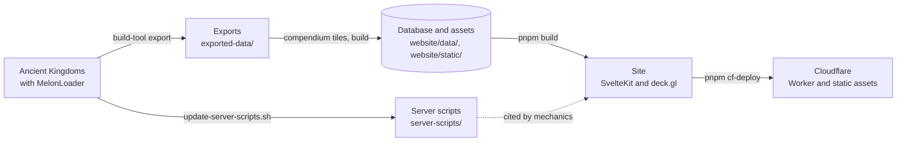

# Ancient Kingdoms Compendium & Mods

An interactive world map and a searchable compendium for [Ancient Kingdoms](https://store.steampowered.com/app/2241380/Ancient_Kingdoms/), an old-school RPG inspired by classic MMORPGs, built from data exported out of the running game. The repository also holds the MelonLoader mods that do the exporting, and a few for players.

[Open the compendium](https://ancient-kingdoms.compendiums.org) · [Steam Guide](https://steamcommunity.com/sharedfiles/filedetails/?id=3616580411) · [Project page](https://glockyco.com/projects/ancient-kingdoms/) · [Support on Ko-fi](https://ko-fi.com/wowmuch)


## What it offers

- **Map** (`/map`). The world of Eratiath with its zones, monsters, NPCs, gathering spots, chests, treasure, altars, traps, portals, and crafting stations, with filters and search.
- **Reference pages.** Items, monsters, NPCs, zones, quests, recipes, skills, classes, mercenaries, professions, and more: where each one is, what it drops or needs, and how they connect.
- **Mechanics** (`/mechanics`). How combat, experience, monster spawns, death, crafting, and the game's other systems work, with the numbers the game code uses.
- **Mods.** Four player mods to download, four more to build yourself, and the mods that the tooling runs in the game. See [Mods](#mods).

Data comes from the running game wherever the export can reach it. Most other values are hardcoded with a citation of the decompiled game code they come from, and a check fails when that code changes. Some content is withheld on purpose, such as zones that have not shipped. [`redactions.toml`](redactions.toml) lists each rule with its reason.

## Mods

### For players

Install [MelonLoader](https://github.com/LavaGang/MelonLoader) in the game, then put a mod's DLL in the game's `Mods` folder, together with FieldDefaultValueHookFix. Settings are in `UserData/MelonPreferences.cfg` in the game folder.

| Mod | What it does | Download |
| --- | --- | --- |
| FieldDefaultValueHookFix | Prevents a crash on world entry under MelonLoader: Il2CppInterop's byte-signature scan matches the wrong function in this game. | [DLL](https://ancient-kingdoms.compendiums.org/mods/FieldDefaultValueHookFix.dll) |
| BetterBestiary | Shows every monster's full Bestiary page, with lore, stats, loot, and skills, without changing kill progress. Alt-left-click a monster to open its page. | [DLL](https://ancient-kingdoms.compendiums.org/mods/BetterBestiary.dll) |
| BossSkillTracker | HUD of ability cooldowns for the bosses, elites, and fabled monsters fighting you or your pet. Out of combat it previews your target. Drag a boss header to move it. | [DLL](https://ancient-kingdoms.compendiums.org/mods/BossSkillTracker.dll) |
| BossTracker | Panel of nearby bosses, elites, and fabled monsters with status, level, distance, direction, and respawn countdowns. Hold Right Shift and drag to move it. | [DLL](https://ancient-kingdoms.compendiums.org/mods/BossTracker.dll) |
| MapEnhancer | Clears fog of war, enables Veteran Awareness, highlights living bosses, and keeps dead bosses and elites on the minimap as grey markers. The cleared fog is saved with the character. | |
| MapTeleporter | Alt-left-click a spot on the open map to teleport there. | |
| MonsterRespawner | Hold Alt to mark dead monsters, then left-click a marker to make that monster ready to respawn. | |
| ResourceRespawner | Hold Alt to mark gathered resources and chests on cooldown, then left-click a marker to make it harvestable. | |

The compendium publishes the first four at stable URLs, listed with their checksums in [`/mods/manifest.json`](https://ancient-kingdoms.compendiums.org/mods/manifest.json). The other four change the game world or your character, so build them from source and use them only where that is appropriate. BossTracker's respawn countdowns and both respawners work only in a world you host, solo play included, because the server holds the values they read or change.

### For the tooling

| Mod | What it does |
| --- | --- |
| CharacterCapture | HotRepl commands that write the local player's planner build to `UserData/CharacterCapture/character-capture.json` (`character.capture`) and read the combat meter totals (`combatMeter.capture`). |
| CombatVerification | HotRepl commands and a damage probe for `build-tool verify`. Not for normal play. |
| DataExporter | Exports the game data as JSON and source images, with `visual_assets.json` listing the images for the build pipeline. Shift-F9 runs it by hand. |
| HierarchyLogger | F9 in the World scene, with or without Shift, writes the scene hierarchy and fog-related components to `hierarchy_dump.txt` in the game folder. |
| HotReplCommands | Typed HotRepl commands for preflight, export, world summary and entry, the scratch database, zone shots, and quitting. `build-tool export` and `verify` drive all but `capture.zoneShots`, which runs by hand. |
| MapScreenshotter | Captures the world-map screenshots that `compendium tiles` stitches. `build-tool export --screenshots` runs it, and Shift-F10 runs it by hand. |

`build-tool deploy` copies every built mod into the game, including the development and state-changing ones.

## How it works



1. **Export.** `build-tool export` launches the game, enters the world, and drives the DataExporter mod through [HotRepl](https://github.com/glockyco/HotRepl). It writes JSON, source images, and the image manifest `visual_assets.json` to `exported-data/`. MapScreenshotter adds the world-map screenshots, and a HotRepl command captures one framed shot per zone.
2. **Evidence.** `scripts/update-server-scripts.sh` decompiles the dedicated server's assembly, which ships with the game, into `server-scripts/`. Hardcoded mechanics cite it, and `compendium build` refuses an export from a different game version.
3. **Build.** The `compendium` CLI in `build-pipeline/` stitches the screenshots into map tiles, loads the exports into `website/data/compendium.db`, applies the redactions, and publishes WebP images to `website/static/images/`.
4. **Site.** SvelteKit prerenders every page except the home page from the database through better-sqlite3. The home page renders in the Cloudflare Worker so that it can compare the published data with the live game version. In the browser, MiniSearch serves search, and sql.js reads a compressed copy of the database for map popups and item tooltips.

### Concepts worth knowing

- **One game install.** Everything targets the Steam install in the CrossOver bottle that `Local.props` names. The mods compile against its MelonLoader assemblies, `deploy` copies into its `Mods` folder, `export` and `verify` launch it, `update` asks the bottle's Steam client to bring it current, and `update-server-scripts.sh` decompiles its server assembly.
- **HotRepl.** A C# REPL and typed command bridge inside the running game. `build-tool export` and `verify` drive the game through it, and the `hotrepl` CLI reaches it by hand.
- **Server scripts.** The client is an IL2CPP build, so the `Assembly-CSharp.dll` that the mods compile against holds only interop wrappers. Read game behaviour in `server-scripts/`. `citations.lock.json` holds a hash of the lines each `Source:` citation covers, so `compendium citations check` notices when a game update changes them.
- **The player save.** `export` uses the player's own save and enters the world as the character whose name sorts first. Work that creates characters, such as `verify` and zone-shot capture, first redirects the game to a scratch database with `game.useScratchDatabase`, so the player save is never written.
- **Redactions.** `compendium build` applies the rules in `redactions.toml` and removes everything left with no other source. `redactions.lock.json` records each removal.
- **Combat engine.** `website/src/lib/planner/` reproduces the game's combat pipeline, and every formula cites its source. Each fixture in `verification/fixtures/` describes a character and a measurement. `build-tool verify` records the measurements in the game, and the website tests compare them with the engine.

## Repository layout

| Path | What it holds |
| --- | --- |
| `mods/` | The MelonLoader mods (C#, `net6.0`). |
| `build-tool/` | `build-tool`, a .NET CLI that sets up the machine, builds and deploys the mods, and runs the game for exports and verification. |
| `build-pipeline/` | `compendium`, a Python CLI that builds the database, images, and map tiles from the exports. It also holds `schema.sql` and the zone-shot focal points. |
| `website/` | The SvelteKit site. |
| `tests/` | C# tests for the mods and `build-tool`. |
| `verification/` | Combat fixtures and the observations measured in the game. |
| `scripts/` | The server-script snapshot script and the clean-checkout check. |
| `docs/game-bugs/` | Reports of defects in the game itself, written for its developer. |
| `openspec/` | Requirements (`specs/`) and the reasoning behind each change (`changes/`). |
| `.agent/skills/` | Step-by-step procedures for recurring work. |

Git ignores the local state: `Local.props` and `config.toml`, the exports in `exported-data/` (all but `README.md` and the hand-maintained `static_data.json`), `.decompiled/` with its `server-scripts` symlink, `website/data/`, and the generated `images/`, `tiles/`, and `mods/` in `website/static/`.

## Getting started

The Nix flake's dev shell provides Node and pnpm, Python and uv, the .NET 10 SDK, and `sqlite3`. With nix-direnv it loads in the working tree. Otherwise run `nix develop`. Every command below assumes the dev shell and the repository root.

Three things the shell cannot provide:

- **Ancient Kingdoms, installed by Steam in a CrossOver bottle on macOS.** The tools launch the game through CrossOver's `wine` and drive the bottle's Steam client. `build-tool setup` finds the install through Steam's manifest for app 2241380.
- **MelonLoader in the game**, launched once so that it generates `MelonLoader/Il2CppAssemblies/`. The mods compile against those assemblies, and `setup` proposes only an install that has them. The repository is developed against MelonLoader 0.7.3.
- **A [HotRepl](https://github.com/glockyco/HotRepl) checkout at `../HotRepl`.** `build-tool deploy-host` builds its MelonLoader host and installs it in the game. HotReplCommands, CombatVerification, CharacterCapture, and `tests/HotReplCommands.Tests` compile against the `HotRepl.Core` Debug build that this produces.

```sh
pnpm install                                  # packages, the Git hooks, and the hotrepl CLI
dotnet run --project build-tool setup         # writes Local.props and config.toml
dotnet run --project build-tool deploy-host   # builds HotRepl and installs its host in the game
```

`setup` proposes the install it finds and the bottle around it, asks for anything it cannot find, and creates `config.toml` from `config.toml.example` when it is absent. Close the game before `deploy-host`.

Then [build and deploy the mods](#build-and-deploy-the-mods). A first build of the site runs these workflows in order: [export](#export-the-game-data) with `--screenshots`, [snapshot the server scripts](#snapshot-the-server-scripts), [capture zone shots](#capture-zone-shots), [build the database](#build-the-database), and [run the site](#run-and-deploy-the-site).

## Common work

### Build and deploy the mods

```sh
dotnet run --project build-tool build    # Release build of every project under mods/
dotnet run --project build-tool deploy   # copy every built mod into the game's Mods folder
```

`build` finds the projects by searching `mods/`, so a mod builds even when `AncientKingdomsMods.sln` does not list it. Close the game before deploying.

### Export the game data

```sh
dotnet run --project build-tool export                 # data and images
dotnet run --project build-tool export --screenshots   # also the world-map screenshots
dotnet run --project build-tool export --update        # update the game through Steam first
```

`export` launches the game, streams `MelonLoader/Latest.log`, runs the export over HotRepl, and quits. It installs nothing, so the HotRepl host, DataExporter, HotReplCommands, and MapScreenshotter must already be deployed. It refuses to start while any Ancient Kingdoms process runs, and it needs at least one character in the player's save. Add `--screenshots` on first setup and whenever the world map changes.

### Snapshot the server scripts

```sh
./scripts/update-server-scripts.sh <version>
```

`<version>` is the `game_version` in `exported-data/game_config.json`, such as `0.9.34.0`, and `compendium build` refuses a snapshot of any other version. The script decompiles the dedicated server's `Assembly-CSharp.dll` from the installed game into `.decompiled/`, points `server-scripts` at the result, and keeps one previous snapshot for diffs. It refuses a new version whose assembly is unchanged. `--force` accepts the rare patch that keeps the server assembly.

### Build the database

From `build-pipeline/`:

```sh
uv run compendium tiles    # screenshots → stitched world image and website/static/tiles/
uv run compendium build    # exports → website/data/compendium.db and website/static/images/
uv run compendium stats    # row counts and database size
```

Run `tiles` before `build`, because `build` crops the zone thumbnails from the stitched world image. `build` also needs a zone shot for every published zone and a server-script snapshot of the exported version, and it replaces its outputs only when every step succeeds. The database stays out of `website/static/`, which is published verbatim.

### Run and deploy the site

```sh
pnpm dev          # development server
pnpm build        # prerender the site
pnpm preview      # serve the last build
pnpm cf-deploy    # build, deploy to production, and notify IndexNow
```

`pnpm dev` and `pnpm build` first run `build-tool publish-mods`, which builds the mods that `website/mod-downloads.json` selects and publishes them at `/mods/<project>.dll` with `/mods/manifest.json`. Both therefore need `Local.props` and the game install, as well as `website/data/compendium.db`. The map's terrain needs `compendium tiles`. After a new `compendium build`, restart `pnpm dev` so that it rebuilds the search index and the compressed database copies.

Two more Workers deploy from `website/`:

```sh
pnpm -C website cf-deploy:demo       # the same build on a separate demo Worker at workers.dev
pnpm -C website cf-deploy:redirect   # the Worker that redirects the old workers.dev hostname
```

### Inspect the running game

```sh
dotnet run --project build-tool launch --wait
pnpm exec hotrepl info --json
pnpm exec hotrepl run world.summary '{}' --json
```

`launch --wait` returns once MelonLoader has loaded, which is before HotReplCommands registers its commands, so an early `run` can fail with `commandNotFound`. HotRepl serves one client, and a new client disconnects the current one, so never attach during an export or a verification run. The [HotRepl skill](.agent/skills/hotrepl-runtime-inspection/SKILL.md) covers measuring live behaviour, and its [command reference](.agent/skills/hotrepl-runtime-inspection/references/commands.md) gives the arguments and results of the typed commands.

### Capture zone shots

Zone shots come from the running game, framed by `build-pipeline/zone_shot_focal_points.json`. `compendium build` needs one for every published zone, so capture them on first setup, when a zone is added, and when a focal point changes. With the mods deployed and the game closed:

```sh
dotnet run --project build-tool launch --wait
pnpm exec hotrepl run game.useScratchDatabase '{}' --json   # must report isScratch=true
# Only when the scratch roster has no fixture character:
pnpm exec hotrepl run fixture.createCharacter '{"characterName":"HomeArt","class":"warrior","race":"human"}' --json
pnpm exec hotrepl run world.enter '{"character":"HomeArt"}' --json
pnpm exec hotrepl run capture.zoneShots '{}' --json
pnpm exec hotrepl run game.quit '{}' --json
```

Redirect to the scratch database before anything else, and never enter the world with a player character. If the redirect refuses, quit and relaunch. The [command reference](.agent/skills/hotrepl-runtime-inspection/references/commands.md) gives the focal-point format and the capture's options.

### Verify combat

```sh
dotnet run --project build-tool verify                             # every fixture
dotnet run --project build-tool verify --fixture A-class-warrior   # one fixture; repeat the option for more
```

`verify` measures each fixture in `verification/fixtures/` in its own game session against a fresh scratch database, and writes `verification/observations/<name>.json` for each fixture that succeeds. Close every Ancient Kingdoms instance first. It needs a server-script snapshot of the installed build. Each run backs up the player save to a `game-dat-backup-*` directory in the game's `ancientkingdoms_Data/`, and nothing prunes those backups.

Compare the observations with the engine:

```sh
pnpm --filter website test src/lib/planner/verification/verification.db.test.ts   # one verdict per fixture
pnpm --filter website test:combat-verification                                    # the strict gate
```

| Verdict | Meaning |
| --- | --- |
| `pass` | Every compared quantity meets its criterion. |
| `fail` | A quantity is outside its criterion. Inspect the fixture, the observation, the game code, and the engine before changing either side. Never widen a tolerance to make a fixture pass. |
| `inconclusive` | Nothing failed, but a measured quantity has fewer samples than the fixture's minimum. Record more samples. |
| `stale` | The observation came from a different game assembly than the current planner data. Record it again on the current build. |
| `missing` | The fixture has no observation yet. |

The first command does not fail on stale, missing, or inconclusive fixtures, so they don't block a game update. The strict gate requires a current `pass` for every fixture, and coverage of every class and companion archetype the engine models and of every damage handler and damage school their skills use.

### Keep BetterBestiary's skill text in step with the site

`mods/BetterBestiary/Skills/SkillEffectFormatter.cs` ports the website's `formatSkillEffect`, which stays the source of truth. A parity test holds the two string-identical over every skill in the database, and the pre-commit hook fails when the committed corpus is stale. After a new export or a change to `formatSkillEffect`, regenerate the corpus and port the change until the test passes:

```sh
pnpm --filter website gen:skill-effect-parity
dotnet test tests/BetterBestiary.Tests
```

### Update to a new game version

The [update-game-version skill](.agent/skills/update-game-version/SKILL.md) gives the order and the gates. In short: update the game, snapshot and diff its server code, reconcile the citations, adapt the exporters, export, rebuild the tiles and the database, review the redactions, update the mechanics, and set `COMPENDIUM_VERSION` last.

## Testing

The pre-commit hook runs the checks for the staged paths, and commitlint requires a Conventional Commit message. The hooks need the full local setup: a website change runs the database suites, a mod change builds every mod against the game, and a redaction change loads the full export. Website jobs run through `nix develop`, and build-pipeline jobs call `uv` directly.

CI runs what needs no game data: Prettier, ESLint, svelte-check, the website tests that need no database, and knip; the C# tests against a pinned HotRepl; ruff, mypy, vulture, and pytest; and OpenSpec validation. It builds neither the site nor the mods. `pnpm cf-deploy` builds before it deploys and stops on a failed build.

Before a release or a change across subsystems, run everything:

```sh
pnpm check                                   # svelte-check, mypy, vulture, knip
pnpm lint                                    # ESLint, ruff
pnpm --filter website format:check
pnpm --filter website test                   # includes the database suites
(cd build-pipeline && uv run pytest)
for project in tests/*/; do dotnet test "$project"; done
dotnet run --project build-tool build
pnpm check:citations                         # needs server-scripts
pnpm check:redactions                        # needs the full export
pnpm check:clean                             # the build-pipeline CI gates on a clean checkout of HEAD
pnpm build
(cd website && node scripts/snapshot-mechanics.mjs)
```

## Rules for changes

### General

- Develop in the primary checkout. The ignored local state listed under [Repository layout](#repository-layout) exists only there.
- Fail when required game data, files, or runtime objects are missing. A default is valid only where the field's contract defines absence. `FieldDefaultValueHookFix` is the one sanctioned exception: when its lookup fails, it logs an error and leaves Il2CppInterop's own lookup in place, the same behaviour as without the mod. Do not add a second.
- Change generated output through its producer, then regenerate. Two inputs are maintained by hand: `exported-data/static_data.json`, and `mods/DataExporter/Curated/classes.json`, which DataExporter embeds and writes over `exported-data/classes.json` on every export. Some generated files are tracked, so commit each with the change that moves it: `home-counts.ts` and `home-showcase.ts` in `website/src/lib/generated/` and `website/static/og-default.png`, which `pnpm build` rewrites, the mechanics snapshots, and the BetterBestiary parity corpus.
- Write `citations.lock.json` only with `compendium citations fix` or `compendium citations sync --game-version <v>`, and `redactions.lock.json` only with `compendium redactions sync --game-version <v>`. Each entry records a check that ran, so a hand edit records one that never did. Review the claim behind a `changed` citation before re-anchoring it.
- Plan a behaviour change as an OpenSpec change under `openspec/changes/`.
- Keep this README to orientation, setup, workflows, rules, and troubleshooting. Put procedures and tool references in `.agent/skills/`, required behaviour and export formats in `openspec/specs/`, redaction rules and their reasons in `redactions.toml`, and defects in the game in `docs/game-bugs/`.

### Game data and mechanics

- Exporters read authoritative runtime data: direct fields and explicit references, with `TryCast<T>()` where the subtype matters. Never infer a value from a name, a threshold, or proximity.
- Absence follows each field's contract: `null` for a missing reference, `""` for missing text, and a declared default only where the contract defines one. The JSON writer omits a `null` property unless the model sets `NullValueHandling.Include`.
- Document a derived value, such as zone containment, at its exporter. JSON property names are snake_case, and manifest paths are relative to `exported-data/`.

Prefer exported data to hand-maintained values. Hardcode a mechanic only when the export cannot carry it, and cite the server-script code it comes from:

```text
// Source: server-scripts/FileName.cs:123-145 — what the cited code establishes
<!-- Source: server-scripts/FileName.cs:MemberName — what the cited code establishes -->
```

Python comments use `#`. Cite a member by name when the claim concerns one member. The claim follows a spaced em or en dash and must name an identifier or a number from the cited code. `compendium citations check` reads the tracked `.ts`, `.js`, `.svelte`, `.py`, `.sql`, and `.cs` files outside `tests` directories, so a citation anywhere else goes unchecked.

### Website

- Only `src/lib/database-assets.ts` imports the database archives. Its header explains why.
- Put new SQL in `src/lib/queries/`, not in route modules.
- Detail pages render every row in the prerendered HTML. Overview pages may paginate.
- Do not hide required content behind hydration. A prerendered page reads without JavaScript.
- Write visible mechanics text with one statement per line and no semicolons. After an intended change to a skill page's Mechanics card, run `pnpm build`, then `node scripts/snapshot-mechanics.mjs --update` in `website/`. Review the changed files in `website/test-fixtures/mechanics-snapshots/` and commit them with the change. No hook or CI job runs this check.
- The map uses game X and negated game Y. Convert at the data boundary: `src/lib/queries/map.server.ts` for prerendered map data, and `src/lib/queries/map-search.ts` for search results read in the browser.
- `src/lib/map/marker-registry.ts` owns each marker layer's precedence and presentation. Layers paint terrain and zones first, then paths, ranges, and areas, then markers by ascending registry `z` with the important ones on top, then selection and hover highlights. `src/lib/map/golden.test.ts` pins the order.

### Mods

- Il2CppInterop exposes a game field as a property, so reflection by field name finds nothing. Read the property first.
- `GetComponents<T>()` returns every match wrapped as `T`. All six attribute components report `PlayerAttribute`, so tell them apart by the member that holds them.
- A plain server field reads as zero on a client of a remote server. A mod that reads one branches on `NetworkServer.active` and says which source its figures come from.
- A refused engine call returns normally and changes nothing. Read the value, act, then read it again.
- Times defined on the server, such as respawn deadlines, use the synchronized server time: `NetworkTime.time` plus the network manager's `offsetNetworkTime`, the sum that the game's `getServerTimeCorrected()` returns.
- A mod marked `[HarmonyDontPatchAll]` applies its patches with one `HarmonyInstance.PatchAll()` call during initialization.

## Troubleshooting

- **`Local.props not found`.** Run `dotnet run --project build-tool setup`.
- **A mod build cannot find the game's assemblies.** Launch the game with MelonLoader once, and check that `ANCIENT_KINGDOMS_PATH` in `Local.props` names the install.
- **HotReplCommands, CombatVerification, or CharacterCapture cannot find `HotRepl.Core`.** Run `dotnet run --project build-tool deploy-host`, which builds it in `../HotRepl`.
- **`deploy` reports `Failed to copy <mod>.dll`.** Close Ancient Kingdoms and deploy again.
- **`export` or `verify` reports `Timed out connecting to HotRepl` or `HotRepl command catalog not ready`.** The HotRepl host or the mods are missing from the game. Run `deploy-host`, `build`, and `deploy`.
- **Export fails with `characterMissing`.** The player's save holds no character. Create one in the game.
- **`game.useScratchDatabase` reports `Scratch parent directory is missing`.** Create the empty directory `ancientkingdoms_Data/verification-scratch/` in the game folder. `build-tool verify` creates it on its first run.
- **The site cannot load the database.** Run `uv run compendium build` in `build-pipeline/`, then restart `pnpm dev` or rerun `pnpm build` so that the search index and the compressed copies are rebuilt.
- **`compendium build` reports a missing stitched world image, screenshot metadata, or zone shot.** Export with `--screenshots`, run `compendium tiles`, and capture zone shots for every published zone.
- **`compendium build` reports that the export's game version does not match the snapshot.** Run `scripts/update-server-scripts.sh` with the exported `game_version`.
- **`compendium tiles` prints `Metadata not found` or fails boss-position validation.** The screenshot set is missing, incomplete, or blank around known boss terrain. Fix the loaded mods or the game state, rerun `build-tool export --screenshots`, then rerun `compendium tiles`.
- **A mod change does nothing in the game.** A Harmony patch that no longer applies, an unregistered command, and a dead coroutine all fail without an error. Read `MelonLoader/Latest.log`, and confirm the change in the running game before reporting it as working.

## Further reading

- [`openspec/specs`](openspec/specs/) states what the pipeline, the site, and the tools must do. Each change under [`openspec/changes`](openspec/changes/) records why it was made.
- [`.agent/skills`](.agent/skills/) holds the procedures for [game updates](.agent/skills/update-game-version/SKILL.md), [exporter changes](.agent/skills/export-game-data/SKILL.md), [runtime inspection](.agent/skills/hotrepl-runtime-inspection/SKILL.md), [save files](.agent/skills/ancient-kingdoms-save-files/SKILL.md), and [game defect reports](.agent/skills/game-defect-reports/SKILL.md).
- [`docs/game-bugs`](docs/game-bugs/) reports defects in the game itself.
- Commit messages explain why each change exists.

## License

MIT. See [LICENSE](LICENSE).

The Ancient Kingdoms Compendium is a fan project. Ancient Kingdoms and its names, artwork, and assets belong to their respective owners.
