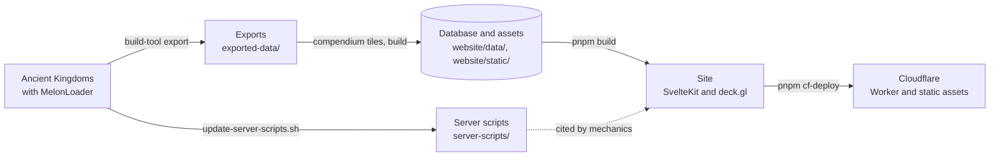

# Ancient Kingdoms Compendium & Mods

An interactive world map, searchable compendium, and MelonLoader mods for players of [Ancient Kingdoms](https://store.steampowered.com/app/2241380/Ancient_Kingdoms/). This unofficial fan project reads data from the game to build its reference pages and map.

[Open the compendium](https://ancient-kingdoms.compendiums.org) · [Steam Guide](https://steamcommunity.com/sharedfiles/filedetails/?id=3616580411) · [Project page](https://glockyco.com/projects/ancient-kingdoms/) · [Support on Ko-fi](https://ko-fi.com/wowmuch)

The compendium's home page links to search, the map, and reference pages.

## What's inside

- Use the map to find monsters, NPCs, gathering spots, and other locations, with filters and search.
- Search the reference pages to look up game entities and follow their locations, drops, requirements, and uses.
- Read the mechanics pages to understand the game's systems and the calculations behind them.

The map shows monster locations, patrol routes, stats, and drops.

The compendium withholds some game content. [redactions.toml](redactions.toml) defines the exclusions.

## Mods for players

You need Ancient Kingdoms and MelonLoader. The latest official MelonLoader (0.7.3) does not work with the current version of the game. Use this [fixed version of MelonLoader](https://github.com/glockyco/ancient-kingdoms-mods/releases/tag/melonloader-0.7.3-unity6000.6) instead. It's an unofficial fix. If it doesn't work for you, you'll have to wait for an official MelonLoader update. Then put the mods you download below in the game's `Mods` folder.

| Mod | What it does | Download |
| --- | --- | --- |
| [FieldDefaultValueHookFix](mods/FieldDefaultValueHookFix/README.md) | Prevents a crash on world entry under MelonLoader. The fixed MelonLoader already includes it. | [DLL](https://ancient-kingdoms.compendiums.org/mods/FieldDefaultValueHookFix.dll) |
| [BetterBestiary](mods/BetterBestiary/README.md) | Shows every monster's full Bestiary page, with lore, stats, loot, and skills. | [DLL](https://ancient-kingdoms.compendiums.org/mods/BetterBestiary.dll) |
| [BossSkillTracker](mods/BossSkillTracker/README.md) | Shows the ability cooldowns of the bosses, elites, and fabled monsters you fight. | [DLL](https://ancient-kingdoms.compendiums.org/mods/BossSkillTracker.dll) |
| [BossTracker](mods/BossTracker/README.md) | Lists nearby bosses, elites, and fabled monsters with their status, distance, direction, and respawn time. | [DLL](https://ancient-kingdoms.compendiums.org/mods/BossTracker.dll) |

Click a mod for its controls and settings. The [mod catalogue](mods/README.md) also lists the mods behind the tooling.

## How it works

Exports, generated data, and deployment stay separate. The exporter writes to `exported-data/`, and the pipeline writes the database and assets used by the website. `pnpm cf-deploy` builds and publishes the site and the player-mod downloads to Cloudflare.

## Development

The tooling runs on macOS, with the game in a CrossOver Steam bottle. Start with [CONTRIBUTING.md](CONTRIBUTING.md) for requirements, setup, workflows, checks, and troubleshooting. A fresh clone needs the local game install and generated data before you can run the site.

[ARCHITECTURE.md](ARCHITECTURE.md) explains the pipeline and code boundaries. [openspec/specs](openspec/specs/) holds the behavior requirements, and [docs/game-bugs](docs/game-bugs/) holds reports about the game.

## License

MIT. See [LICENSE](LICENSE).

Ancient Kingdoms and its names, artwork, and assets belong to their respective owners.
