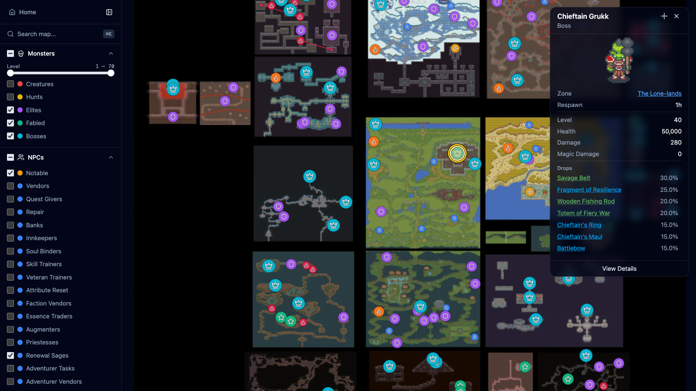
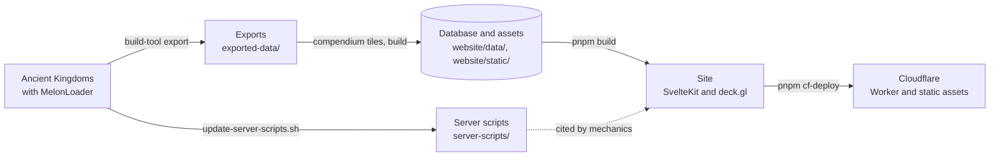

# Ancient Kingdoms Compendium & Mods

An interactive world map and a searchable compendium for [Ancient Kingdoms](https://store.steampowered.com/app/2241380/Ancient_Kingdoms/), an old-school RPG inspired by classic MMORPGs, built from the game's own data. The repository also holds the MelonLoader mods that read that data out of the game, and four mods for players.

[Open the compendium](https://ancient-kingdoms.compendiums.org) · [Steam Guide](https://steamcommunity.com/sharedfiles/filedetails/?id=3616580411) · [Project page](https://glockyco.com/projects/ancient-kingdoms/) · [Support on Ko-fi](https://ko-fi.com/wowmuch)



## What it offers

- **Map** (`/map`). The world of Eratiath with its zones, monsters, NPCs, gathering spots, chests, treasure, altars, traps, portals, and crafting stations, with filters and search.
- **Reference pages.** Items, monsters, NPCs, zones, quests, recipes, skills, classes, mercenaries, professions, and more: where each one is, what it drops or needs, and how they connect.
- **Mechanics** (`/mechanics`). How combat, experience, monster spawns, death, crafting, and the game's other systems work, with the numbers the game code uses.

Some content is left out on purpose, partly at the developers' request, such as zones that have not shipped.

## Mods for players

Install [MelonLoader](https://github.com/LavaGang/MelonLoader) in the game, then put the DLLs in the game's `Mods` folder. Always include FieldDefaultValueHookFix. Settings are in `UserData/MelonPreferences.cfg` in the game folder.

| Mod | What it does | Download |
| --- | --- | --- |
| FieldDefaultValueHookFix | Prevents a crash on world entry under MelonLoader. | [DLL](https://ancient-kingdoms.compendiums.org/mods/FieldDefaultValueHookFix.dll) |
| BetterBestiary | Shows every monster's full Bestiary page, with lore, stats, loot, and skills, without changing kill progress. Alt-left-click a monster to open its page. | [DLL](https://ancient-kingdoms.compendiums.org/mods/BetterBestiary.dll) |
| BossSkillTracker | HUD of ability cooldowns for the bosses, elites, and fabled monsters fighting you or your pet. Out of combat it previews your target. Drag a boss header to move it. | [DLL](https://ancient-kingdoms.compendiums.org/mods/BossSkillTracker.dll) |
| BossTracker | Panel of nearby bosses, elites, and fabled monsters with status, level, distance, direction, and respawn countdowns. Hold Right Shift and drag to move it. Countdowns appear only in a world you host, solo play included, because only the server knows respawn times. | [DLL](https://ancient-kingdoms.compendiums.org/mods/BossTracker.dll) |

[`/mods/manifest.json`](https://ancient-kingdoms.compendiums.org/mods/manifest.json) lists the downloads with their checksums. The other mods in `mods/` serve the tooling and testing; [How it works](#the-mods-behind-it) lists them.

## How it works



1. **Export.** `build-tool export` launches the game, enters the world, and drives the DataExporter mod through [HotRepl](https://github.com/glockyco/HotRepl). It writes JSON, source images, and the image manifest `visual_assets.json` to `exported-data/`. MapScreenshotter adds the world-map screenshots, and a HotRepl command captures one framed shot per zone.
2. **Evidence.** `scripts/update-server-scripts.sh` decompiles the game's server code into `server-scripts/`. Mechanics that the export cannot carry cite it.
3. **Build.** The `compendium` CLI in `build-pipeline/` stitches the screenshots into map tiles, loads the exports into `website/data/compendium.db`, applies the redactions, and publishes WebP images to `website/static/images/`.
4. **Site.** SvelteKit prerenders every page except the home page from the database. The home page renders in the Cloudflare Worker so that it can compare the published data with the live game version. In the browser, MiniSearch serves search, and sql.js reads a compressed copy of the database for map popups and item tooltips.

### The mods behind it

| Mod | Role |
| --- | --- |
| DataExporter | Reads the game data, images, and `visual_assets.json` out of the running game. Shift-F9 runs it by hand. |
| MapScreenshotter | Captures the world-map screenshots for the tiles. Shift-F10 runs it by hand. |
| HotReplCommands | Typed HotRepl commands for the export, world entry, the scratch database, zone shots, and quitting. |
| CombatVerification | Fixture and probe commands for [combat verification](#verify-combat). Not for normal play. |
| CharacterCapture | Captures the local player's build and the combat meter totals for the combat engine. |
| HierarchyLogger | F9 in the World scene, with or without Shift, writes the scene hierarchy to `hierarchy_dump.txt` in the game folder. |
| MapEnhancer, MapTeleporter, MonsterRespawner, ResourceRespawner | Gameplay mods that change the world or the character: they reveal the map, teleport from it, and reset monster and resource respawns. They stay out of the downloads. |

`build-tool deploy` installs every built mod, including all of these.

### Concepts worth knowing

- **HotRepl.** A C# REPL and typed command bridge inside the running game. `build-tool export` and `verify` drive the game through it, and the `hotrepl` CLI reaches it by hand. It serves one client, and a new client disconnects the current one, so never attach while an export or a verification run is using it.
- **Server scripts.** The client is an IL2CPP build, so the `Assembly-CSharp.dll` that the mods compile against holds only interop wrappers. The game's logic is read in `server-scripts/`, decompiled from the dedicated server that ships with the game.
- **Versions.** Three markers agree after a game update: the installed Steam build, the decompiled snapshot recorded in `server-scripts/SNAPSHOT.toml`, and the published `COMPENDIUM_VERSION`. `compendium build` refuses an export from a different game version than the snapshot, verification marks an observation from a different assembly as stale, and the home page compares `COMPENDIUM_VERSION` with the live game.
- **Registries.** Cross-cutting definitions have one owner. `website/src/lib/entities/entity-manifest.json` declares each entity kind's routes, search kind, and sitemap membership, and `website/src/lib/map/marker-registry.ts` declares every map marker layer.
- **Combat engine.** `website/src/lib/planner/` reproduces the game's combat formulas, and the monster and mercenary stat figures use its math. Fixtures in `verification/fixtures/` describe characters and measurements, and `build-tool verify` records them in the game to check the engine.

## What the project protects

Four commitments explain the system and every rule a contributor must follow.

### Facts match the current game build

The site publishes what the installed build does. A guess is worse than a gap.

- Exporters read authoritative runtime data and never infer a value from a name, a threshold, or proximity. The [export-game-data skill](.agent/skills/export-game-data/SKILL.md) holds the full data contract.
- Missing data stops the export or the build. A default is valid only where a field's contract defines absence. A mod that cannot find what it needs logs an error and turns the affected feature off.
- A mechanic that the export cannot carry cites the decompiled code it comes from, as `// Source: server-scripts/File.cs:Member — claim`, with `#` in Python and `<!-- -->` in Svelte markup. `compendium citations check` fails when the cited lines change. A pass proves only that they did not, so review the claim whenever its code changes.
- A failing combat fixture gets investigated. Never widen its criterion to make it pass.
- A game update follows the [update-game-version skill](.agent/skills/update-game-version/SKILL.md), and `COMPENDIUM_VERSION` changes last.

### Withheld content stays withheld

Some content stays off the site, partly at the developers' request: zones that have not shipped, positions that the game itself hides, crafting details of some items, and named entities.

- `redactions.toml` holds each rule with its reason. `compendium build` removes everything a rule reaches, and `redactions.lock.json` records each removal.
- Every published output applies the rules: pages and search read the redacted database, and the image, tile, and zone-shot steps apply the same rules. A new output must apply them too, and `compendium redactions verify` must check it.

### The player's save stays untouched

The tools run the real game on the real install, whose save holds real characters.

- A session that creates or changes characters first redirects the game to the scratch database with `game.useScratchDatabase`, and never enters the world as a player character. A refused redirect means quit and relaunch, never continue.
- Inspect save files only as copies. The [save-files skill](.agent/skills/ancient-kingdoms-save-files/SKILL.md) gives the procedure.

### Every output has one producer

- Change generated output by changing its producer and rerunning it. In `exported-data/`, only `static_data.json` is maintained by hand. Class metadata lives in `mods/DataExporter/Curated/classes.json`, which every export copies over `exported-data/classes.json`.
- Some generated files are tracked: `website/src/lib/generated/`, `website/static/og-default.png`, the mechanics snapshots, and the BetterBestiary parity corpus. Commit each with the change that regenerates it.
- `citations.lock.json` and `redactions.lock.json` record checks that ran. Write them only with `compendium citations fix`, `compendium citations sync --game-version <v>`, and `compendium redactions sync --game-version <v>`.

## Repository layout

| Path | What it holds |
| --- | --- |
| `mods/` | The MelonLoader mods (C#, `net6.0`). |
| `build-tool/` | `build-tool`, a .NET CLI that sets up the machine, builds and deploys the mods, and runs the game for exports and verification. |
| `build-pipeline/` | `compendium`, a Python CLI that builds the database, images, and map tiles from the exports. It also holds `schema.sql` and the zone-shot focal points. |
| `website/` | The SvelteKit site. |
| `tests/` | C# tests for the mods and `build-tool`. |
| `verification/` | Combat fixtures and the observations measured in the game. |
| `scripts/` | The server-script snapshot script and the clean-checkout check. |
| `docs/game-bugs/` | Reports of defects in the game itself, written for its developer. |
| `openspec/` | Requirements (`specs/`) and the reasoning behind each change (`changes/`). |
| `.agent/skills/` | Step-by-step procedures for recurring work. |

Git ignores the local state: `Local.props` and `config.toml`, the exports in `exported-data/` (all but `README.md` and `static_data.json`), `.decompiled/` with its `server-scripts` symlink, `website/data/`, and the generated `images/`, `tiles/`, and `mods/` in `website/static/`. It exists only in the primary checkout, so work there rather than in a worktree.

## Getting started

The Nix flake's dev shell provides Node and pnpm, Python and uv, the .NET 10 SDK, and `sqlite3`. With nix-direnv it loads in the working tree. Otherwise run `nix develop`. Every command below assumes the dev shell and the repository root.

Three things the shell cannot provide:

- **Ancient Kingdoms, installed by Steam in a CrossOver bottle on macOS.** The tools launch the game through CrossOver's `wine` and drive the bottle's Steam client.
- **MelonLoader in the game**, launched once so that it generates `MelonLoader/Il2CppAssemblies/`. The mods compile against those assemblies. The repository is developed against MelonLoader 0.7.3.
- **A [HotRepl](https://github.com/glockyco/HotRepl) checkout at `../HotRepl`.** `build-tool deploy-host` builds its MelonLoader host, installs it in the game, and produces the `HotRepl.Core` build that HotReplCommands, CombatVerification, CharacterCapture, and `tests/HotReplCommands.Tests` compile against.

```sh
pnpm install                                  # packages, the Git hooks, and the hotrepl CLI
dotnet run --project build-tool setup         # finds the game and writes Local.props and config.toml
dotnet run --project build-tool deploy-host   # builds HotRepl and installs its host in the game
dotnet run --project build-tool build         # builds every project under mods/
dotnet run --project build-tool deploy        # copies the built mods into the game
```

Close the game before `deploy-host` and `deploy`. Then [build the data](#export-and-build-the-data) and [run the site](#run-and-deploy-the-site).

## Workflows

### Export and build the data

A first build runs every step, in this order. Later builds repeat only the steps whose inputs changed.

1. `dotnet run --project build-tool export` exports the game data. Add `--screenshots` on first setup and when the world map changes, and `--update` to update the game through Steam first. The command installs nothing, so the HotRepl host and the mods must already be deployed. It needs a character in the save and refuses to start while the game runs.
2. `./scripts/update-server-scripts.sh <version>` decompiles the installed server code. `<version>` is the `game_version` in `exported-data/game_config.json`.
3. Capture zone shots on first setup, when a zone is added, and when a focal point in `build-pipeline/zone_shot_focal_points.json` changes. The [HotRepl skill](.agent/skills/hotrepl-runtime-inspection/SKILL.md#capture-zone-shots) gives the procedure.
4. `uv run compendium tiles` in `build-pipeline/` stitches the screenshots into the world image and the map tiles.
5. `uv run compendium build` in `build-pipeline/` builds the database and the images. It needs the stitched world image, a zone shot for every published zone, and the snapshot of the exported version. It replaces its outputs only when every step succeeds.

### Run and deploy the site

```sh
pnpm dev          # development server
pnpm build        # prerender the site
pnpm preview      # serve the last build
pnpm cf-deploy    # build, deploy to production, and notify IndexNow
```

`pnpm dev` and `pnpm build` first run `build-tool publish-mods`, which builds the mods that `website/mod-downloads.json` selects and publishes them under `/mods/`. Both therefore need `Local.props` and the game install, as well as `website/data/compendium.db`. After a new `compendium build`, restart `pnpm dev` so that it rebuilds the search index and the compressed database copies.

`pnpm -C website cf-deploy:demo` deploys the same build to a separate demo Worker on workers.dev, and `pnpm -C website cf-deploy:redirect` deploys the Worker that redirects the old workers.dev hostname to the site.

### Inspect the running game

```sh
dotnet run --project build-tool launch --wait
pnpm exec hotrepl info --json
pnpm exec hotrepl run world.summary '{}' --json
```

`launch --wait` returns once MelonLoader has loaded. HotReplCommands registers its commands a little later, so an early `run` can fail with `commandNotFound`. The [HotRepl skill](.agent/skills/hotrepl-runtime-inspection/SKILL.md) covers the typed commands and how to measure live behaviour.

### Verify combat

```sh
dotnet run --project build-tool verify                                            # every fixture, or --fixture <name>
pnpm --filter website test src/lib/planner/verification/verification.db.test.ts   # one verdict per fixture
pnpm --filter website test:combat-verification                                    # the strict gate
```

`verify` runs each fixture in its own game session against a fresh scratch database and writes `verification/observations/<name>.json` for each fixture that succeeds. Close every Ancient Kingdoms instance first. The per-fixture comparison fails only on a `fail` verdict, so stale observations do not block a game update. The strict gate requires a current pass for every fixture. The [combat-verification spec](openspec/specs/combat-verification/spec.md) defines the verdicts and the coverage the gate requires.

### Update to a new game version

The [update-game-version skill](.agent/skills/update-game-version/SKILL.md) gives the order and the gates. In short: update the game, snapshot and diff its server code, reconcile the citations, adapt the exporters, export, rebuild the tiles and the database, review the redactions, update the mechanics, and set `COMPENDIUM_VERSION` last.

## Checks

The pre-commit hook runs the checks for the staged paths, and commitlint requires a Conventional Commit message. The hooks need the full local setup: a website change runs the database suites, a mod change builds every mod against the game, and a redaction change loads the full export. CI repeats the checks that need no game data, and it builds neither the site nor the mods.

Before a release or a change across subsystems, run everything:

```sh
pnpm check                                   # svelte-check, mypy, vulture, knip
pnpm lint                                    # ESLint, ruff
pnpm --filter website format:check
pnpm --filter website test                   # includes the database suites
(cd build-pipeline && uv run pytest)
for project in tests/*/; do dotnet test "$project"; done
dotnet run --project build-tool build
pnpm check:citations                         # needs server-scripts
pnpm check:redactions                        # needs the full export
pnpm check:clean                             # the build-pipeline CI gates on a clean checkout of HEAD
pnpm build
(cd website && node scripts/snapshot-mechanics.mjs)
```

The last command compares each skill page's Mechanics card with its snapshot. After an intended change to a card, run it with `--update` and commit the snapshots with the change.

## Game runtime facts

These hold for mod, exporter, and HotRepl code alike.

- Il2CppInterop exposes a game field as a property, so reflection by field name finds nothing.
- `GetComponents<T>()` returns every match wrapped as `T`. All six attribute components report `PlayerAttribute`, so tell them apart by the member that holds them.
- On a client of a remote server, a plain server field reads as zero, and a SyncVar write changes only the local copy. Branch on `NetworkServer.active` and say which source a figure comes from. The HotRepl skill's [client and server reference](.agent/skills/hotrepl-runtime-inspection/references/client-and-server.md) lists what a client can read and change.
- A refused engine call returns normally and changes nothing. Read the value, act, then read it again.
- Times defined on the server, such as respawn deadlines, use `NetworkTime.time` plus the network manager's `offsetNetworkTime`, the sum that the game's `getServerTimeCorrected()` returns.

## Troubleshooting

- **A mod build cannot find the game's or HotRepl's assemblies.** Launch the game with MelonLoader once so that it generates its assemblies, check `ANCIENT_KINGDOMS_PATH` in `Local.props`, and run `deploy-host`, which builds `HotRepl.Core` in `../HotRepl`.
- **`export` or `verify` reports `Timed out connecting to HotRepl` or `HotRepl command catalog not ready`.** The HotRepl host or the mods are missing from the game. Run `deploy-host`, `build`, and `deploy`.
- **`compendium tiles` fails boss-position validation.** The screenshots are incomplete or blank around boss terrain. Fix the loaded mods or the game state, then export with `--screenshots` again.
- **A mod change does nothing in the game.** A Harmony patch that no longer applies, an unregistered command, and a dead coroutine all fail without an error. Read `MelonLoader/Latest.log`, and confirm the change in the running game before reporting it as working.

## Where knowledge lives

- **This README**: what the project is, how it fits together, what it protects, setup, workflows, and troubleshooting.
- **[`.agent/skills`](.agent/skills/)**: procedures for [game updates](.agent/skills/update-game-version/SKILL.md), [exporter changes](.agent/skills/export-game-data/SKILL.md), [runtime inspection and zone shots](.agent/skills/hotrepl-runtime-inspection/SKILL.md), [save files](.agent/skills/ancient-kingdoms-save-files/SKILL.md), and [game defect reports](.agent/skills/game-defect-reports/SKILL.md).
- **[`openspec/specs`](openspec/specs/)**: required behaviour. Plan a behaviour change as a change under [`openspec/changes`](openspec/changes/).
- **`redactions.toml`**: each redaction rule and its reason.
- **[`docs/game-bugs`](docs/game-bugs/)**: defects in the game itself.
- **Code comments and commit messages**: why the code is the way it is, and why each change was made.

Put each new fact in its home, and keep this README to the first item.

## License

MIT. See [LICENSE](LICENSE).

The Ancient Kingdoms Compendium is a fan project. Ancient Kingdoms and its names, artwork, and assets belong to their respective owners.
