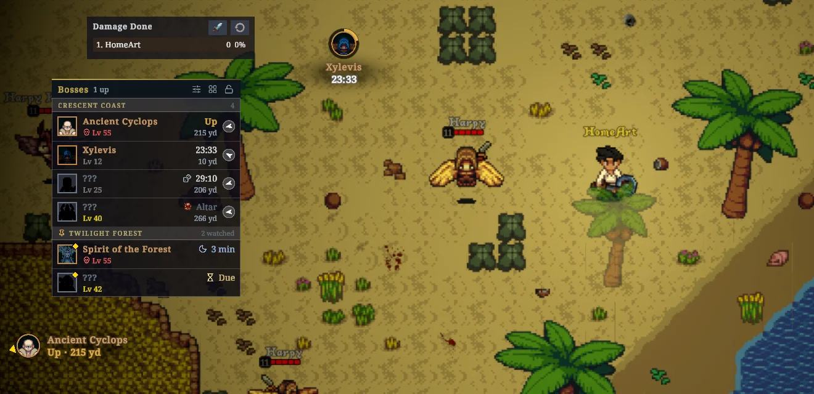
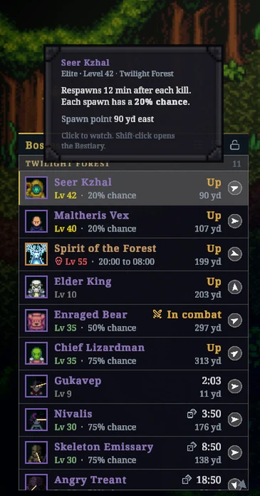
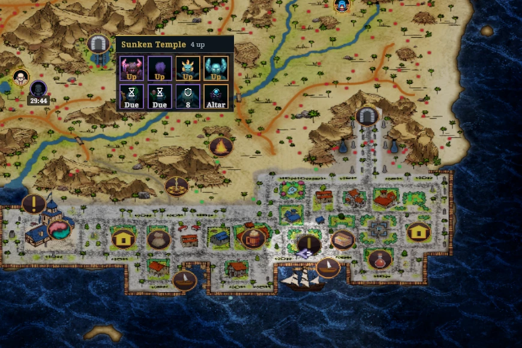
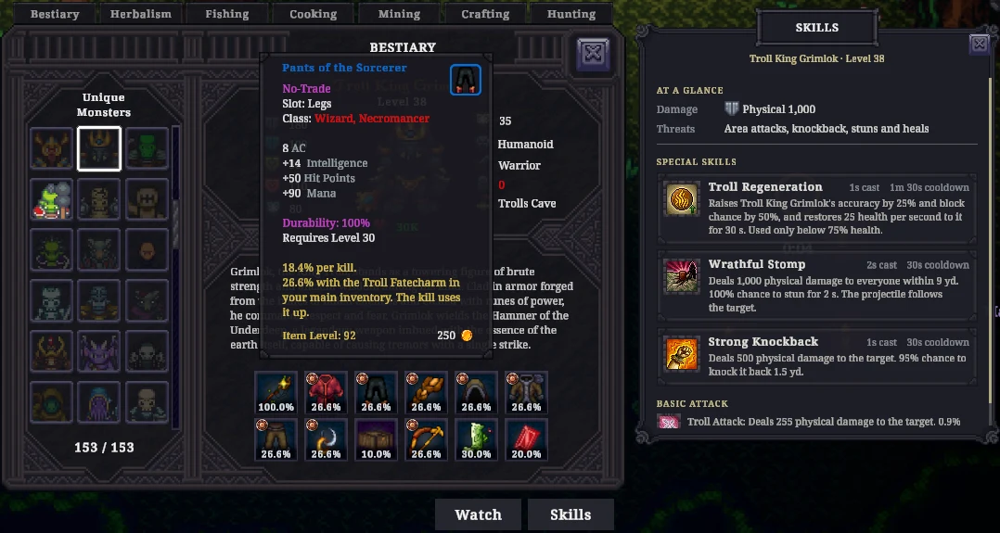
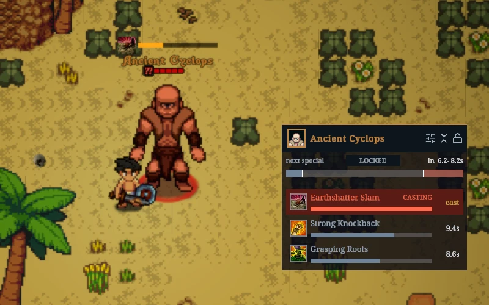
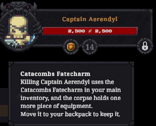
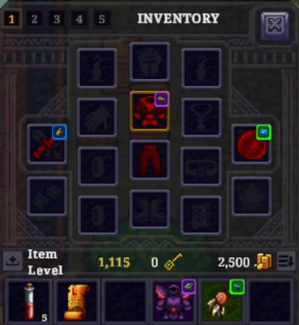

# Pocket Compendium

Pocket Compendium is a MelonLoader mod for Ancient Kingdoms. It shows when bosses, elites, and fabled monsters spawn and where to find them. It also opens the full Bestiary page of any monster, even one you haven't discovered yet.

The mod only displays information. It doesn't change combat, loot, or spawns.

[Download PocketCompendium.dll](https://ancient-kingdoms.compendiums.org/mods/PocketCompendium.dll)

## Install

1. Install MelonLoader as [Mods for players](../../README.md#mods-for-players) describes.
2. If you have BossTracker.dll, BossSkillTracker.dll, or BetterBestiary.dll in the game's `Mods` folder, delete them. Pocket Compendium includes everything they did, and they conflict with it.
3. Copy PocketCompendium.dll into the `Mods` folder.

## Use

- Click a monster in the boss list to get an alert when it spawns.
- Shift-click it, or hold Alt and click the monster in the world, to open its Bestiary page.
- Hover over a row, map pin, skill or drop for details.
- Press F8 for the settings.

## Features

### Boss list

Lists the bosses, elites, and fabled monsters in your zone and when they spawn. Times are exact in a world you host, and in a friend's world when you both use the mod. Elsewhere they are estimates and start with `~`.

### Map pins and world markers

Marks respawn timers on the map and on spawn points, and points to monsters off screen. Hover over a dungeon's entrance to see its bosses.

### Bestiary

Shows every monster's page, with drop chances, skills and respawn timers. A bar on each monster fills as you find its drops.

### Boss skills

Shows the skill cooldowns of the monsters you're fighting.

### Fatecharms

Warns you when killing your target would use your Fatecharm.

### Augment marks

Marks each item that has an augment with the augment's icon, in your inventory, backpack, bank and house chest. The frame takes the augment's quality colour.

## Problems and ideas

Use **Report a problem** or **Suggest an idea** on the About page of the settings. Without a GitHub account, post in the compendium channel on the [game's Discord](https://discord.gg/8MkSWjXwab).

When a feature stops after an error, a card names it. **Report** opens the problem form with your setup's details, and **Turn on again** restarts the feature. The feature's settings row also has **Report**, and its switch turns the feature on again.

## License

MIT. See [LICENSE](../../LICENSE).
