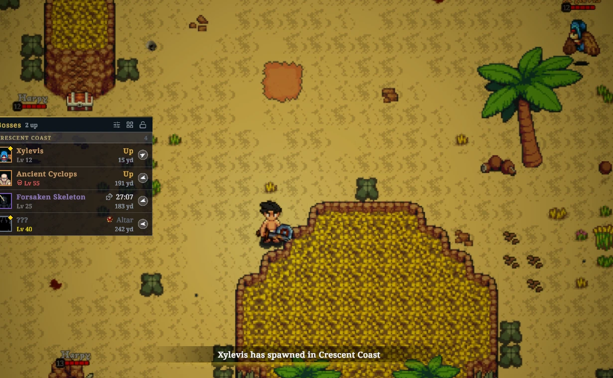

# Pocket Compendium

Pocket Compendium is a MelonLoader mod for Ancient Kingdoms. It shows when bosses, elites, and fabled monsters spawn and where to find them. It also opens the full Bestiary page of any monster, even one you haven't discovered yet.

The mod only displays information. It doesn't change combat, loot, or spawns.

[Download PocketCompendium.dll](https://ancient-kingdoms.compendiums.org/mods/PocketCompendium.dll)

## Install

1. Install MelonLoader as [Mods for players](../../README.md#mods-for-players) describes.
2. If you have BossTracker.dll, BossSkillTracker.dll, or BetterBestiary.dll in the game's `Mods` folder, delete them. Pocket Compendium includes everything they did, and they conflict with it.
3. Copy PocketCompendium.dll into the `Mods` folder.

## Use

- Click a monster in the boss list to get an alert when it spawns.
- Shift-click it, or hold Alt and click the monster in the world, to open its Bestiary page.
- Hover over a row, map pin, skill or drop for details.
- Press F8 for the settings.

## Features

### Boss list

Lists the bosses, elites, and fabled monsters in your zone and when they spawn. A time that starts with `~` is an estimate.

### Map pins and world markers

Marks respawn timers on the map and on spawn points, and points to monsters off screen.

### Alerts

Tells you on screen and in chat when a monster you watch spawns.

### Bestiary

Shows every monster's page, with drop chances, skills and respawn timers.

### Boss skills

Shows the skill cooldowns of the monsters you're fighting.

### Fatecharms

Warns you when killing your target would use your Fatecharm.

### Sharing

Shares exact times with other players in your world who use the mod.

## Problems and ideas

Use **Report a problem** or **Suggest an idea** on the About page of the settings. Without a GitHub account, post in the compendium channel on the [game's Discord](https://discord.gg/8MkSWjXwab).

## License

MIT. See [LICENSE](../../LICENSE).
