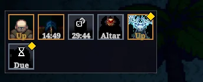
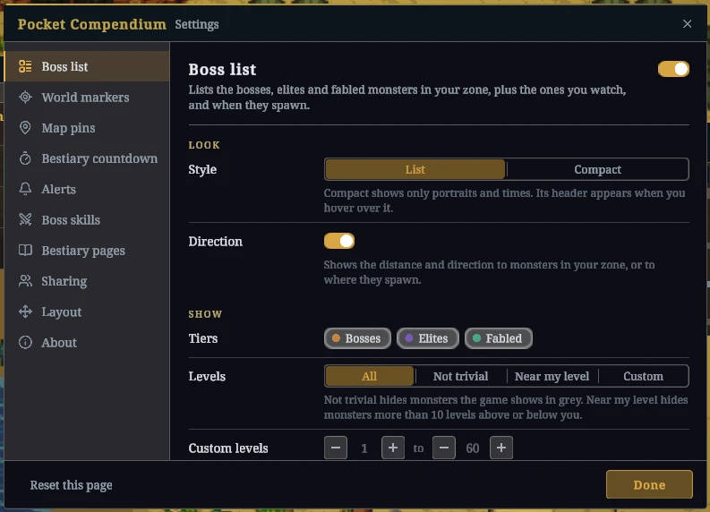

# Pocket Compendium

Pocket Compendium is a MelonLoader mod for Ancient Kingdoms. It shows when bosses, elites, and fabled monsters spawn and where to find them. It also opens the full Bestiary page of any monster, even one you haven't met yet.

The mod only displays information. It doesn't change combat, loot, or spawns.

[Download PocketCompendium.dll](https://ancient-kingdoms.compendiums.org/mods/PocketCompendium.dll)

## Install

1. Install MelonLoader as [Mods for players](../../README.md#mods-for-players) describes.
2. If you have BossTracker.dll, BossSkillTracker.dll, or BetterBestiary.dll in the game's `Mods` folder, delete them. Pocket Compendium includes everything they did, and they conflict with it.
3. Copy PocketCompendium.dll into the `Mods` folder.

The next time you enter a world, the boss list appears on the left side of the screen. Press F8 to open the settings.

## Boss list

The list shows the bosses, elites, and fabled monsters in your current zone, plus any you watch. Hover over a row to see its spawn rules, when it was last killed, and where it spawns.

| Display | Meaning |
| --- | --- |
| Up | It's alive. |
| Swords and In combat | It's alive and fighting. |
| A time | It respawns in that time. |
| Dice and a time | It might spawn then. The tooltip shows the chance. |
| Hourglass and Due | Its time has passed. It spawns, or rolls its chance, once someone is in its zone. |
| Moon or sun | It only spawns at night or only during the day. The time shows when that starts. |
| Shield and a number | It spawns once other monsters die. The number shows how many are left. |
| An item and Altar | It only appears during an altar event, which you start with that item. |
| Eye | You've seen it alive on this server, but its timer is unknown. A crossed-out eye means you haven't seen it there yet. |
| `~` before a time | The time is an estimate. |
| ??? and a silhouette | You haven't met it yet. |
| Skull before the level | It's more than 10 levels above you. |

Click a row to watch that monster. Watched monsters stay in the list in every zone, have a gold corner, and trigger an alert when they spawn. Shift-click a row to open the monster's Bestiary page. The grid button at the top of the list switches to compact tiles.

### Exact and estimated times

Times are exact in a world you host. In a friend's world, they're exact too, as long as you both use Pocket Compendium. On other servers, the mod only knows what you see: kills you witness, corpses you find, and kill announcements on dedicated servers, which only cover bosses. These times are estimates and start with `~`. The mod remembers them for each server.

## World markers and map pins

Dead monsters in your zone are marked on their spawn point with a respawn timer. If a monster is alive but off screen, an arrow at the edge of the screen points to it. On the local map, each monster in your zone has a pin. Hover over a pin to see its spawn rules, or click it to watch the monster.

## Alerts

When a watched monster spawns, the game announces it on screen and in chat, for example "Xylevis has spawned in Crescent Coast." If the mod only has estimated times for a server, the alert comes when you see the monster alive.

## Bestiary

Every Bestiary page shows the monster's stats, lore, and drops, including monsters you haven't met yet. Hover over a drop to see the item's full tooltip. Click **Skills** below the page to see the monster's skills. Dead monsters show their respawn timer on their portrait and on their page. To open a monster's page from the world, hold Alt and click the monster.

With a gamepad, move right from the monster grid to reach the drops, down to reach **Skills**, and left to go back.

## Boss skills

During a fight, a panel shows the skills of every boss, elite, and fabled monster attacking you or your pet. It shows each skill's cooldown and when the next special attack can come. Out of combat, select one of these monsters to preview its skills. Drag the panel's header to move it, and drag its corner to resize it.

## Settings

Press F8 to open the settings. You can turn off any feature, and most have options. **Reset this page** restores the defaults of the page you're on. On the Layout page, you can lock or reset all panels and change the key that opens the settings.

Settings are saved in `UserData/MelonPreferences.cfg`, in the sections starting with `PocketCompendium_`. Estimated times for other servers are saved in `UserData/PocketCompendium/Worlds`.

## Language

Monster, skill, zone, and item names follow the game's language setting. Everything else the mod adds is in English.

## Limits

- On someone else's server, a boss can show as Up after a server restart until someone enters its zone. The server only applies its respawn timer at that point.
- The boss skills panel only shows monsters near you. On someone else's server, the time until the next special attack is an estimate based on the casts you see.
- If a feature stops working, the other features keep running.

## Problems and ideas

Use **Report a problem** or **Suggest an idea** on the About page of the settings (F8). Both open a [form on GitHub](https://github.com/glockyco/ancient-kingdoms-mods/issues/new/choose). Without a GitHub account, post in the compendium channel on the [game's Discord](https://discord.gg/8MkSWjXwab).

## Development

[CONTRIBUTING.md](../../CONTRIBUTING.md) covers building, deploying, and checks.

## License

MIT. See [LICENSE](../../LICENSE).
